<div align="center">

# 🩸 Blood Cell Type Classification Using Microscopy

### Deep Learning on BloodMNIST · ResNet-18 vs DenseNet-121 vs EfficientNet-B0


</div>

A course project for **Artificial Intelligence and Deep Learning (24CS312PC310)** at **SR University**.
It classifies microscopic peripheral blood-cell images into **8 classes** by fine-tuning three ImageNet-pretrained CNNs under identical settings, then compares them on accuracy, probability quality and computational cost.

> ⚠️ **Disclaimer:** This is an educational experiment. It has not been clinically validated and must **not** be used for diagnosis.

---

## 📑 Table of Contents

- [Overview](#-overview)
- [Highlights](#-highlights)
- [Dataset](#-dataset)
- [Technology Stack](#️-technology-stack)
- [Project Workflow](#-project-workflow)
- [Methodology](#-methodology)
- [Model Architectures](#-model-architectures)
- [Results](#-results)
- [Computational Performance](#-computational-performance)
- [Key Findings](#-key-findings)
- [Project Structure](#-project-structure)
- [Getting Started](#️-getting-started)
- [Output Files](#-output-files)
- [Limitations](#-limitations)
- [Future Scope](#️-future-scope)
- [References](#-references)
- [Author](#-author)

---

## 📖 Overview

Blood carries oxygen, fights infection and takes part in clotting. In haematology, a **peripheral blood smear** (a thin layer of blood stained on a glass slide) is examined under a microscope to identify the different cell types. Besides red cells and platelets, a smear contains several kinds of white blood cells, each with a characteristic nucleus shape, cytoplasm and granule pattern.

Counting and recognising these cells by eye is slow, repetitive and needs trained staff. Judgements can also vary between observers, especially for cells in intermediate stages of development. **Automated recognition** from microscope images is therefore an active application area for computer vision.

This project builds an image classifier that takes **one microscopic blood-cell image** and predicts which of **eight categories** it belongs to. Three well-known CNN architectures are trained on the same data under the same conditions, and their results are compared to find the most suitable model.

### 🎯 Problem Statement

| Challenge | Why it matters |
|:---|:---|
| **Expertise and time** | Manual identification needs trained personnel and is time-consuming |
| **Visual similarity** | Classes such as neutrophils and immature granulocytes look alike and are hard to separate |
| **Class imbalance** | In the training set the largest class (neutrophil) is about 2.7× the smallest (lymphocyte) |
| **Choice of architecture** | It is not obvious in advance which network gives the best balance of accuracy and cost |

### 💡 Proposed Approach

- Use **transfer learning**: start from networks pretrained on ImageNet, replace the final layer with 8 outputs and fine-tune all layers.
- Compare **three architectures with different design ideas**: residual connections (ResNet-18), dense connections (DenseNet-121) and compound scaling (EfficientNet-B0).
- Keep **preprocessing, optimiser, loss and stopping rule identical** so the comparison is fair.
- Use a **class-weighted loss** to address class imbalance.
- Select the best model on the **validation set** and reserve the **test set** for the final comparison.

### 🧭 Objectives and Scope

- Prepare BloodMNIST using the **official** training, validation and test splits.
- Fine-tune ResNet-18, DenseNet-121 and EfficientNet-B0 with identical settings.
- Evaluate with **multiple metrics**, not accuracy alone.
- Produce confusion matrices, ROC curves, precision-recall curves, training curves and a model-comparison summary.
- Select the best model by **validation macro-F1** and report its test performance.
- Compare computational cost (training and inference time).

**In scope:** eight-class classification of single-cell images from BloodMNIST using three CNNs.
**Out of scope:** transformer-based or custom-designed networks, pathological cells, and clinical use.

### ⚡ At a Glance

| | |
|:---|:---|
| **Task** | 8-class blood-cell image classification |
| **Dataset** | BloodMNIST, 17,092 RGB images at 224 × 224 |
| **Models** | ResNet-18 · DenseNet-121 · EfficientNet-B0 |
| **Framework** | PyTorch on Google Colab (Tesla T4) |
| **Selection rule** | Highest validation macro-F1 |
| **Selected model** | 🏆 EfficientNet-B0 (val macro-F1 0.9963) |
| **Selected model, test** | Accuracy 99.01% · Macro-F1 0.9910 · Macro ROC-AUC 0.9993 |
| **Best test accuracy** | DenseNet-121, 99.06% (two images ahead of EfficientNet-B0) |
| **Fastest to train** | ResNet-18, 9.4 min |
| **Main remaining error** | Neutrophil ↔ immature granulocyte confusion |

### 🏁 Results Snapshot

| Model | Params | Test accuracy | Test macro-F1 | Train time |
|:---|:-:|:-:|:-:|:-:|
| ResNet-18 | 11.18 M | 98.80% | 0.9900 | 9.4 min |
| DenseNet-121 | 6.96 M | **99.06%** | **0.9917** | 28.6 min |
| 🏆 EfficientNet-B0 | **4.02 M** | 99.01% | 0.9910 | 22.8 min |

Full metric tables, curves and analysis are in the [Results](#-results) section.

### 🔬 How It Works (in one view)


---

## ✨ Highlights

- 🔬 **8-class** blood-cell classification on **17,092** RGB microscope images (224 × 224).
- 🧠 **3 architectures** compared fairly: ResNet-18, DenseNet-121, EfficientNet-B0.
- ⚖️ **Class-weighted cross-entropy** to handle class imbalance (largest class ≈ 2.7× the smallest).
- 📏 **11 evaluation metrics**, confusion matrices, ROC and precision-recall curves.
- 🏆 Best model chosen by **validation macro-F1**, never by test performance.
- ♻️ **Reproducible**: fixed seed (42), official dataset splits, one notebook run top to bottom.
- 💾 Checkpoints, figures and CSV results saved to Google Drive and packed into a ZIP.

---

## 🧫 Dataset

The project uses **BloodMNIST** from the [MedMNIST](https://medmnist.com) collection, derived from microscopic images of normal peripheral blood cells. The **224 × 224** release is used and loaded with the `medmnist` package (v3.0.2).

| Property | Details |
|:---|:---|
| Dataset | BloodMNIST (MedMNIST) |
| Total images | 17,092 |
| Classes | 8 |
| Image type | RGB microscopic images |
| Task | Multi-class classification |
| Resolution | 224 × 224 |

### Official Splits (used unmodified)

| Split | Images | Share |
|:---|---:|---:|
| Training | 11,959 | 70.0% |
| Validation | 1,712 | 10.0% |
| Testing | 3,421 | 20.0% |
| **Total** | **17,092** | **100%** |

### Class Schema

| # | Class | Train | Val | Test | Description |
|:-:|:---|---:|---:|---:|:---|
| 1 | Basophil | 852 | 122 | 244 | Large dark-staining granules; least frequent white cell |
| 2 | Eosinophil | 2,181 | 312 | 624 | Bi-lobed nucleus with orange-red granules |
| 3 | Erythroblast | 1,085 | 155 | 311 | Nucleated red-cell precursor with round dense nucleus |
| 4 | Immature granulocytes | 2,026 | 290 | 579 | Myelocytes, metamyelocytes and promyelocytes grouped |
| 5 | Lymphocyte | 849 | 122 | 243 | Small round cell, large dense nucleus |
| 6 | Monocyte | 993 | 143 | 284 | Largest white cell, kidney-shaped nucleus |
| 7 | Neutrophil | 2,330 | 333 | 666 | Most common white cell, multi-lobed nucleus |
| 8 | Platelet | 1,643 | 235 | 470 | Small cell fragment involved in clotting |

### Class Weights (computed from training labels only)

Formula: `w_c = N / (K · n_c)` with `N` = training images, `K` = 8 classes, `n_c` = images in class `c`.

| Basophil | Eosinophil | Erythroblast | Immature gran. | Lymphocyte | Monocyte | Neutrophil | Platelet |
|:-:|:-:|:-:|:-:|:-:|:-:|:-:|:-:|
| 1.755 | 0.685 | 1.378 | 0.738 | 1.761 | 1.505 | 0.642 | 0.910 |

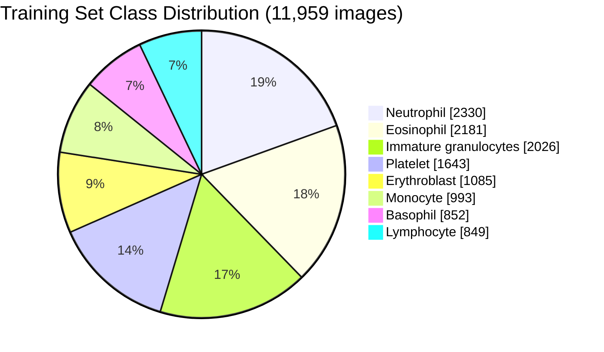

---

## 🛠️ Technology Stack

| Category | Technology |
|:---|:---|
| Language | Python |
| Deep Learning | PyTorch, torchvision |
| Dataset Library | MedMNIST 3.0.2 |
| Evaluation | scikit-learn |
| Data Handling | NumPy, pandas |
| Visualisation | Matplotlib, seaborn |
| Platform | Google Colab |
| Hardware | NVIDIA Tesla T4 GPU |
| Storage | Google Drive (checkpoints, figures, results) |
| Optimiser | AdamW |
| Precision | Mixed precision (AMP) |

---

## 🔄 Project Workflow

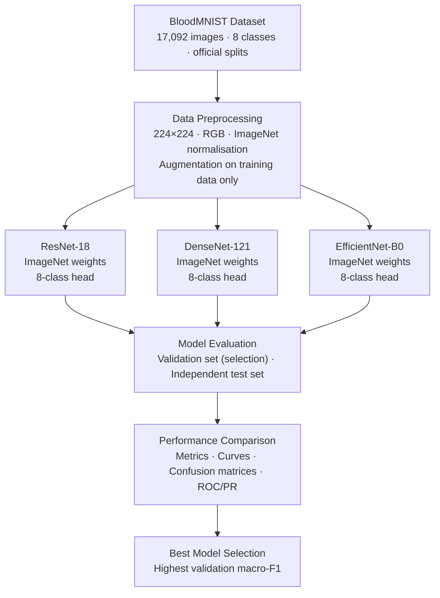

### Training and Checkpointing Procedure

Applied identically to each model.

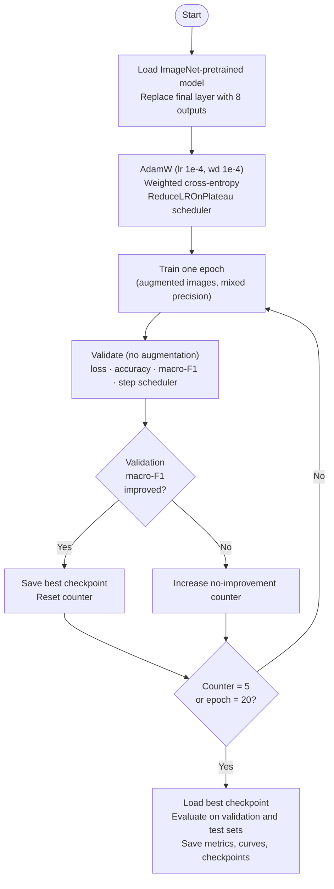

---

## 🧪 Methodology

### Image Preparation

| Step | Applied to | Purpose |
|:---|:---|:---|
| Resize to 224 × 224 | All splits | Common input size for pretrained networks |
| RGB conversion | All splits | Ensure three channels |
| Tensor conversion + ImageNet normalisation | All splits | Match pretrained model conventions |
| Random horizontal flip | Training only | Increase variation |
| Random vertical flip | Training only | Increase variation |
| Random rotation (±20°) | Training only | Robustness to cell orientation |

### Training Configuration (identical for all models)

| Parameter | Value |
|:---|:---|
| Input size | 224 × 224 |
| Batch size | 32 |
| Max epochs | 20 |
| Optimiser | AdamW |
| Initial learning rate | 0.0001 |
| Weight decay | 0.0001 |
| Loss | Weighted cross-entropy |
| LR scheduler | ReduceLROnPlateau on val loss (factor 0.5, patience 2) |
| Early stopping | Patience 5 on validation macro-F1 |
| Checkpoint | Epoch with highest validation macro-F1 |
| Pretrained weights | ImageNet (torchvision) |
| Mixed precision | Enabled on GPU |
| Random seed | 42 |
| Output classes | 8 |

### Evaluation Metrics

| Metric | What it measures | Better |
|:---|:---|:-:|
| Accuracy | Fraction of images classified correctly | ⬆️ |
| Precision | `TP / (TP + FP)` | ⬆️ |
| Recall | `TP / (TP + FN)` | ⬆️ |
| Macro F1 | Mean per-class F1 | ⬆️ |
| Weighted F1 | Per-class F1 weighted by class size | ⬆️ |
| Specificity | `TN / (TN + FP)`, one-vs-rest | ⬆️ |
| ROC-AUC | Macro one-vs-rest area under ROC | ⬆️ |
| Probability RMSE | Error between probabilities and one-hot labels | ⬇️ |
| Brier score | Summed squared probability error per image | ⬇️ |
| Cohen's kappa | Agreement beyond chance | ⬆️ |
| MCC | Matthews correlation coefficient | ⬆️ |

---

## 🧠 Model Architectures

All three are convolutional networks. Parameter counts include the new 8-class head.

| Feature | ResNet-18 | DenseNet-121 | EfficientNet-B0 |
|:---|:---|:---|:---|
| Main technique | Residual connections | Dense connections | Compound scaling, MBConv |
| Depth | 18 layers | 121 layers | B0 configuration |
| Feature learning | Residual learning | Feature reuse | Efficient extraction |
| Final layer input | 512 | 1024 | 1280 |
| Parameters | 11.18 M | 6.96 M | 4.02 M |
| Role in study | Baseline | Dense feature connections | Computational efficiency |

### ResNet-18


### DenseNet-121


### EfficientNet-B0


### Key Building Blocks

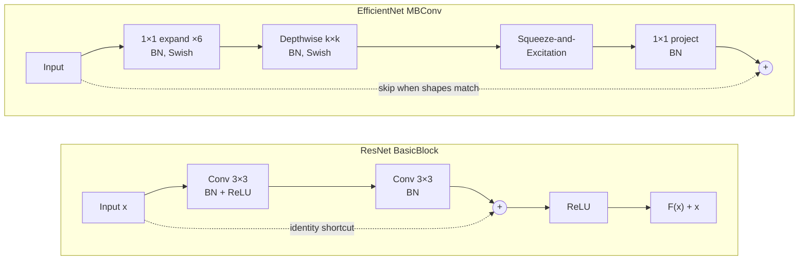

---

## 📊 Results

All values come from a single run of the notebook on a Colab Tesla T4.

### Training Summary

| Model | Params (M) | Epochs run | Best epoch | Stopped because | Best val macro-F1 | Train time (min) |
|:---|:-:|:-:|:-:|:---|:-:|:-:|
| ResNet-18 | 11.18 | 12 | 7 | Early stopping | 0.9944 | 9.4 |
| DenseNet-121 | 6.96 | 16 | 11 | Early stopping | 0.9958 | 28.6 |
| EfficientNet-B0 | 4.02 | 20 | 17 | 20 epochs reached | **0.9963** | 22.8 |

### Test-Set Metrics (final comparison)

| Metric | ResNet-18 | DenseNet-121 | EfficientNet-B0 |
|:---|:-:|:-:|:-:|
| Accuracy | 0.9880 | **0.9906** | 0.9901 |
| Precision | 0.9904 | **0.9911** | 0.9905 |
| Recall | 0.9900 | **0.9924** | 0.9916 |
| Macro F1 | 0.9900 | **0.9917** | 0.9910 |
| Weighted F1 | 0.9880 | **0.9906** | 0.9900 |
| Specificity | 0.9982 | **0.9986** | 0.9985 |
| ROC-AUC | **0.9994** | 0.9993 | 0.9993 |
| Probability RMSE ⬇️ | 0.0491 | **0.0430** | 0.0455 |
| Brier score ⬇️ | 0.0193 | **0.0148** | 0.0165 |
| Cohen's kappa | 0.9860 | **0.9891** | 0.9884 |
| MCC | 0.9861 | **0.9891** | 0.9884 |

Correct predictions out of 3,421 test images: ResNet-18 **3,380** (41 errors), DenseNet-121 **3,389** (32 errors), EfficientNet-B0 **3,387** (34 errors).

### Validation-Set Metrics

| Metric | ResNet-18 | DenseNet-121 | EfficientNet-B0 |
|:---|:-:|:-:|:-:|
| Accuracy | 0.9930 | 0.9953 | 0.9953 |
| Precision | 0.9936 | 0.9953 | 0.9961 |
| Recall | 0.9953 | 0.9963 | 0.9966 |
| Macro F1 | 0.9944 | 0.9958 | **0.9963** |
| Weighted F1 | 0.9930 | 0.9953 | 0.9953 |
| Specificity | 0.9990 | 0.9993 | 0.9993 |
| ROC-AUC | 0.9998 | 1.0000 | 1.0000 |
| Probability RMSE ⬇️ | 0.0384 | 0.0328 | 0.0327 |
| Brier score ⬇️ | 0.0118 | 0.0086 | 0.0085 |
| Cohen's kappa | 0.9918 | 0.9945 | 0.9945 |
| MCC | 0.9918 | 0.9945 | 0.9946 |

### 🏆 Model Selection (by validation macro-F1)

| Rank | Model | Val macro-F1 | Test macro-F1 | Test accuracy | Best epoch |
|:-:|:---|:-:|:-:|:-:|:-:|
| 🥇 1 | **EfficientNet-B0** | 0.9963 | 0.9910 | 0.9901 | 17 |
| 🥈 2 | DenseNet-121 | 0.9958 | 0.9917 | 0.9906 | 11 |
| 🥉 3 | ResNet-18 | 0.9944 | 0.9900 | 0.9880 | 7 |

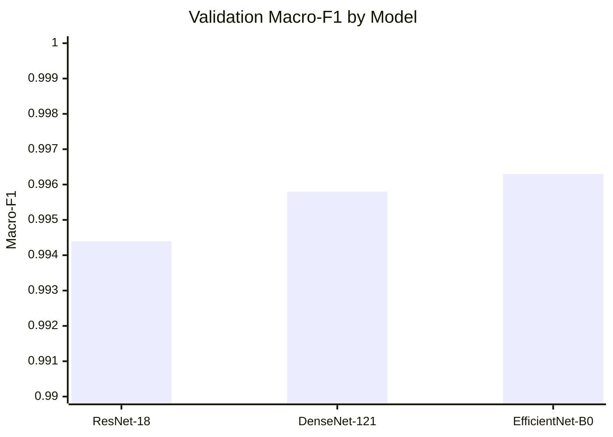

### Per-Class Test Performance (F1-score)

| Class | ResNet-18 | DenseNet-121 | EfficientNet-B0 |
|:---|:-:|:-:|:-:|
| Basophil | 0.9959 | 0.9919 | 0.9959 |
| Eosinophil | 0.9992 | 0.9992 | 0.9992 |
| Erythroblast | 0.9968 | 0.9968 | 0.9919 |
| Immature granulocytes | 0.9706 | 0.9766 | 0.9774 |
| Lymphocyte | 0.9938 | 0.9939 | 0.9938 |
| Monocyte | 0.9895 | 0.9929 | 0.9878 |
| Neutrophil | 0.9746 | 0.9827 | 0.9820 |
| Platelet | 1.0000 | 1.0000 | 1.0000 |

### Main Source of Error

Most mistakes are between **neutrophils** and **immature granulocytes**, both granulocyte-lineage cells that can look alike.

| Model | Neutrophil → Immature gran. | Immature gran. → Neutrophil |
|:---|:-:|:-:|
| ResNet-18 | 31 | 0 |
| DenseNet-121 | 11 | 11 |
| EfficientNet-B0 | 7 | 14 |

> Platelets and eosinophils are classified without error by all three models.

### 🖼️ Figures

Generated figures are saved in [`outputs/figures/`](outputs/figures/). Add them here after running the notebook:

| Training curves | Confusion matrices |
|:-:|:-:|
| 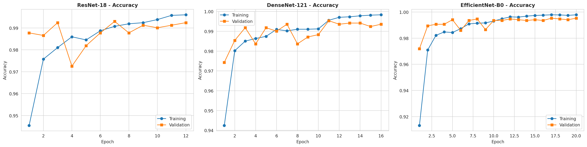 | 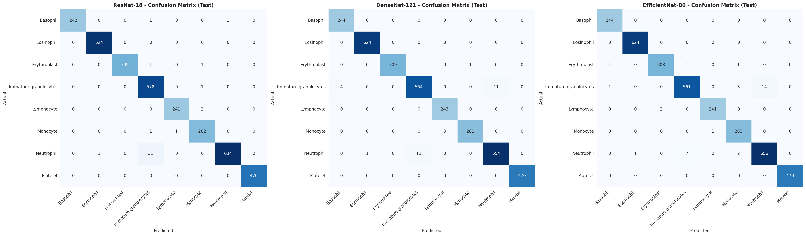 |

| ROC curves | Precision-recall curves |
|:-:|:-:|
| 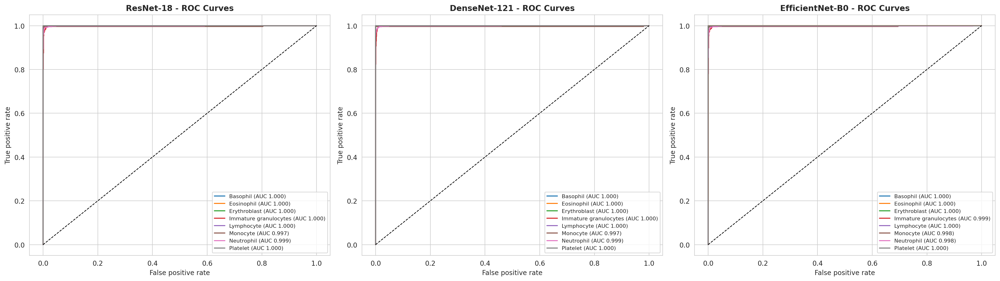 | 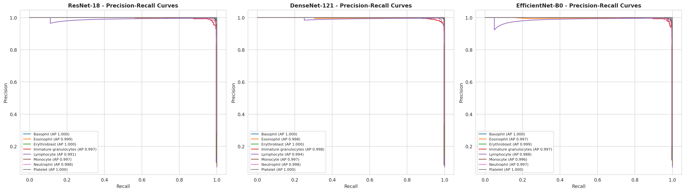 |

| Actual vs predicted | Model ranking |
|:-:|:-:|
| 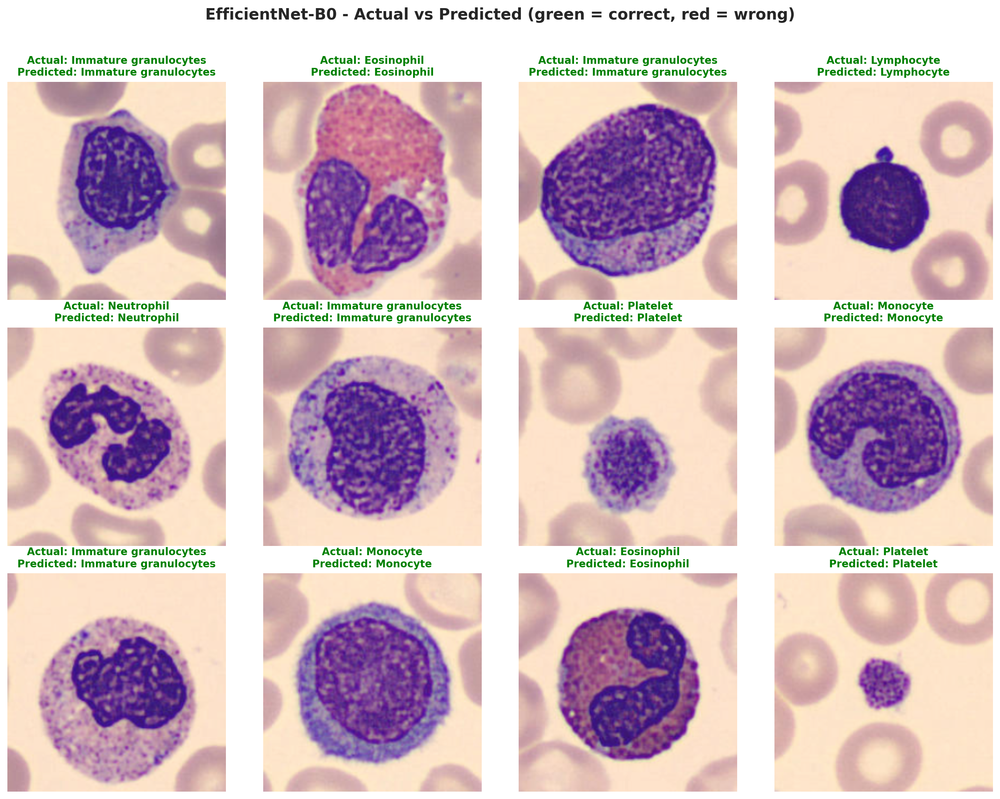 | 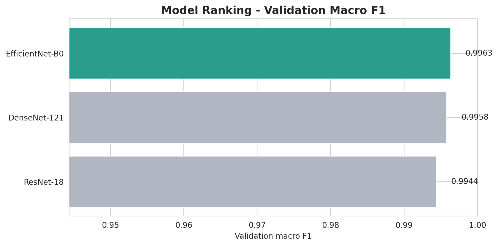 |

---

## ⚡ Computational Performance

| Model | Params (M) | Epochs | Train time (min) | Time / epoch (min) | Test inference (s) | Per image (ms) |
|:---|:-:|:-:|:-:|:-:|:-:|:-:|
| ResNet-18 | 11.18 | 12 | **9.45** | **0.79** | **6.18** | **1.81** |
| DenseNet-121 | 6.96 | 16 | 28.58 | 1.79 | 13.40 | 3.92 |
| EfficientNet-B0 | **4.02** | 20 | 22.80 | 1.14 | 8.47 | 2.48 |

> Timings come from one run on a shared Colab GPU. Inference time includes data loading and preprocessing, so it is not pure model latency. Time per epoch is the fairer comparison because early stopping changes epoch counts.

---

## 💡 Key Findings

- ✅ All three models are excellent: test accuracy **98.80% to 99.06%**, macro ROC-AUC **0.9993 to 0.9994**.
- 🏆 **EfficientNet-B0** is selected by the validation rule. It has the fewest parameters and near-best test accuracy (99.01%).
- 🔁 **DenseNet-121** is marginally ahead on the test set (a difference of **two images**), so with a single run neither can be declared better with confidence.
- 🎯 DenseNet-121 has the best probability quality (lowest RMSE and Brier score) at the highest compute cost.
- ⚡ **ResNet-18** is the fastest, training in about a third of DenseNet-121's time, but is weakest on neutrophil vs immature granulocyte.
- 📉 Training behaviour is healthy: the train/validation gap is small and validation curves flatten.

---

## 📁 Project Structure

```text
Blood-Cell-Classification/
│
├── notebooks/
│   └── Blood_Cell_Classification.ipynb
│
├── outputs/
│   ├── figures/        # curves, confusion matrices, ROC/PR, comparisons
│   ├── checkpoints/    # best_model.pth and per-model checkpoints
│   └── results/        # CSV metrics, histories, rankings, predictions
│
├── reports/
│   └── Blood_Cell_Classification_Report.pdf
│
├── README.md
├── requirements.txt
└── .gitignore
```

### Notebook Layout (47 cells)

| Part | Content |
|:-:|:---|
| 1–2 | Installs, imports, configuration (hyper-parameters, seed, device, output folders) |
| 3 | Load BloodMNIST with official splits, transforms and labels |
| 4 | Dataset visualisations: samples, class distribution, split distribution |
| 5 | Class weights and data loaders |
| 6 | Pretrained models with 8-output heads and parameter counts |
| 7 | Training loop, evaluation functions, metric computation |
| 8 | Training of ResNet-18, DenseNet-121, EfficientNet-B0 |
| 9–11 | Accuracy/loss curves, confusion matrices, ROC and PR curves |
| 12–14 | Comparison tables and charts, class-wise F1, classification reports |
| 15 | Best-model selection and ranking chart |
| 16–17 | Actual vs predicted examples, saving results, ZIP download |

---

## ⚙️ Getting Started

### Prerequisites

- Python 3.10+
- A CUDA GPU is recommended (the project was run on a Colab Tesla T4)
- Git

### 1. Clone the Repository

```bash
git clone https://github.com/<your-username>/Blood-Cell-Classification.git
cd Blood-Cell-Classification
```

### 2. Install Dependencies

```bash
python3 -m venv .venv
source .venv/bin/activate        # Windows: .venv\Scripts\activate
pip install -r requirements.txt
```

### 3. Run the Notebook

**Option A: Google Colab (recommended)**

1. Upload `notebooks/Blood_Cell_Classification.ipynb` to Colab.
2. Select **Runtime → Change runtime type → T4 GPU**.
3. Run all cells from top to bottom. BloodMNIST downloads automatically.

Set `DRIVE = True` in the configuration cell to save outputs to Google Drive so they survive a runtime disconnect. With `DRIVE = False`, outputs go to a local `outputs/` folder.

**Option B: Local Jupyter**

```bash
jupyter notebook notebooks/Blood_Cell_Classification.ipynb
```

> The comparison cells stop with an error unless all three models have finished training, so a winner can never be chosen from a partial run. A resume file is saved after every epoch, so an interrupted run can continue.

---

## 📦 Output Files

| Folder | Files |
|:---|:---|
| `outputs/figures/` | `sample_images.png`, `class_distribution_train.png`, `class_distribution_splits.png`, `accuracy_curves.png`, `loss_curves.png`, `confusion_matrices.png`, `roc_curves.png`, `precision_recall_curves.png`, `model_comparison_metrics.png`, `classwise_f1.png`, `time_comparison.png`, `model_ranking.png`, `actual_vs_predicted.png` |
| `outputs/checkpoints/` | `best_model.pth`, per-model best checkpoints, `*_last.pth` resume files |
| `outputs/results/` | `history_<model>.csv`, `validation_metrics_comparison.csv`, `test_metrics_comparison.csv`, `classwise_f1.csv`, `model_ranking.csv`, `best_validation_epoch.csv`, `split_class_counts.csv`, test-set predictions |

The notebook also packs everything into `blood_cell_project_outputs.zip`.

---

## ⚠️ Limitations

- Each model was trained **once** with one seed on the official split; differences between models are not statistically tested.
- Data covers **normal cells** from healthy individuals in a limited acquisition setting, so results may not transfer to pathological samples or other laboratories.
- 224 × 224 images are resampled versions of the original microscope images.
- Performance is near the ceiling, which limits how clearly models can be separated.
- Validation scores are slightly optimistic because validation was used for early stopping, scheduling and model selection. Only test scores are independent.
- Timing comes from a single run on a shared GPU.
- Not clinically validated.

---

## 🗺️ Future Scope

- Multiple seeds or cross-validation with confidence intervals.
- External validation on other labs, stains and microscopes, including abnormal cells.
- Comparison with transformer-based or hybrid models and larger EfficientNet/ResNet variants.
- Improving the neutrophil / immature granulocyte boundary (targeted augmentation, focal loss, ensembling).
- Explainability with Grad-CAM and calibration analysis.
- Cell detection or segmentation for full smear images, plus a simple deployable app.

---

## 📚 References

1. A. Acevedo et al., "A dataset of microscopic peripheral blood cell images for development of automatic recognition systems," *Data in Brief*, vol. 30, 2020.
2. J. Yang et al., "MedMNIST v2: A large-scale lightweight benchmark for 2D and 3D biomedical image classification," *Scientific Data*, vol. 10, 2023.
3. K. He et al., "Deep residual learning for image recognition," CVPR, 2016.
4. G. Huang et al., "Densely connected convolutional networks," CVPR, 2017.
5. M. Tan and Q. V. Le, "EfficientNet: Rethinking model scaling for CNNs," ICML, 2019.
6. J. Deng et al., "ImageNet: A large-scale hierarchical image database," CVPR, 2009.
7. I. Loshchilov and F. Hutter, "Decoupled weight decay regularization," ICLR, 2019.
8. A. Paszke et al., "PyTorch: An imperative style, high-performance deep learning library," NeurIPS, 2019.
9. F. Pedregosa et al., "Scikit-learn: Machine learning in Python," JMLR, vol. 12, 2011.
10. P. Micikevicius et al., "Mixed precision training," ICLR, 2018.

The full reference list is in [`reports/Blood_Cell_Classification_Report.pdf`](reports/Blood_Cell_Classification_Report.pdf).

---

## 👨‍💻 Author

**P. Srikar**

B.Tech, Computer Science and Engineering (AI & ML)
School of Computer Science & Artificial Intelligence, SR University, Warangal, Telangana, India

---

<div align="center">

### 🩸 Blood Cell Type Classification

**Transfer learning for microscopic blood-cell recognition**

Made for learning · Not for clinical use

</div>
